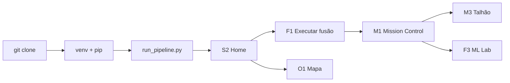

# Experiência do professor — clone ao produto

## O que o avaliador espera (implícito)

1. Clonar e rodar **sem perguntar ao grupo**
2. Ver **código + resultado** coerentes
3. Sentir **produto**, não script solto
4. Navegar **telas** que contam história

## Jornada alvo (5 min)

## O que já funciona hoje

| Etapa | Status |
|-------|--------|
| clone + pipeline | ✅ |
| F1 Executar fusão | ✅ |
| M1 Mission Control | ✅ |
| S2, M3, F3, O1 | 📋 spec pronta — Codex |

## Mensagem na README (topo)

Professor: comece por **`REPRODUCE.md`**, depois **`docs/demo_script_5min.md`**.

## Specs = contrato para IAs

Cada tela em `specs/task10_global_solution/screens/` define o que **deve existir**. Sem spec, a IA inventa dashboard genérico.

## Sua sessão Codex (recomendada)

1. Abrir `specs/task10_global_solution/CODEX_BRIEF.md`
2. Rodar sessões 1→5 em ordem
3. Gravar vídeo seguindo `demo_script_5min.md`
4. Igor polish visual depois (não bloqueia Codex)
